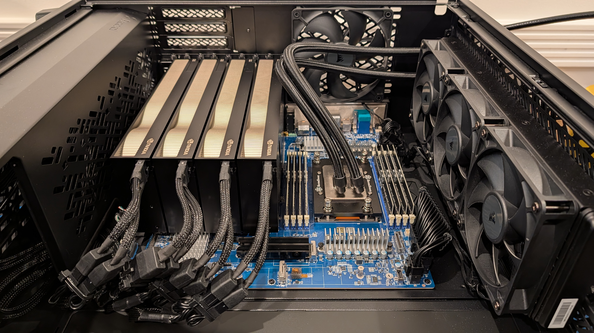

# Single-Outlet Inference

A workstation serving [GLM-5.3-Flash](https://huggingface.co/nvidia/GLM-5.3-Flash-NVFP4)
(sparse-MLA MoE with native vision, 1M-token context) with
[vLLM](https://github.com/nick-oconnor/vllm).



## Benchmarks

GLM-5.3-Flash (NVFP4 checkpoint, MTP3 speculative decoding) on vLLM
`vllm/vllm-openai:v0.33.0` with native KV offload and upstream's FlashInfer
PCIe IPC all-reduce. 16 prompts, concurrency 1, random dataset, zero failed
requests. Decode is the MTP output rate (2.24-2.46 accepted tokens/step); all TTFTs
are cold prefill. Measured in-cluster against the live deployment.

| Input Tokens | Output Tokens | Decode (tok/s) | Median TTFT | Median ITL |
| --------- | ---------- | -------------- | --------- | -------- |
| 2048      | 256        | 161.00         | 237ms     | 12.94ms  |
| 8192      | 1024       | 152.43         | 758ms     | 13.02ms  |
| 32768     | 4096       | 162.88         | 2492ms    | 13.07ms  |
| 131072    | 8192       | 145.29         | 9838ms    | 13.27ms  |

PSU output (self-reported via the PSU's USB interface): 236W idle, 1.22kW
under bench load, 1.79kW peak.

## Hardware

| Component | Spec |
|---|---|
| Motherboard | Gigabyte MH53-G40 |
| CPU | 1x AMD Ryzen Threadripper PRO 9985WX |
| Memory | 8x Kingston KF556R28-32 RDIMM, EXPO 1 |
| GPU | 4x NVIDIA RTX PRO 6000 Blackwell Max-Q, ECC enabled |
| Interconnect | 4x PCIe Gen 5 x16 |
| PSU | 1x Corsair HX1500i, 20A 120V circuit |
| OS / driver | Debian 13, kernel 7.1.13, NVIDIA 615.71.09, CUDA 13.4 |

Memory Bandwidth:

| Threads | Pinning | Copy |
| --- | --- | --- |
| 8 | 1 per CCD | 263GB/s |
| 16 | 2 per CCD (SMT pair) | 293GB/s |
| 32 | 4 per CCD | 209GB/s |
| 128 | default | 137GB/s |

PCIe Topology:

|     | GPU0 | GPU1 | GPU2 | GPU3 |
| --- | ---- | ---- | ---- | ---- |
| GPU0 | X    | NODE | NODE | NODE |
| GPU1 | NODE | X    | NODE | NODE |
| GPU2 | NODE | NODE | X    | NODE |
| GPU3 | NODE | NODE | NODE | X    |

PCIe Speed (between GPU pairs):

| P2P        | Unidirectional | Bidirectional | Latency (GPU) | Latency (CPU) |
| ---------- | -------------- | ------------- | ------------- | ------------- |
| disabled   | 44GB/s         | 58GB/s        | 14us          | 5us           |
| enabled    | 55GB/s         | 105GB/s       | 0.5us         | 1us           |

## Model

[GLM-5.3-Flash](https://huggingface.co/zai-org/GLM-5.3-Flash): sparse-MLA
MoE, 320B total / 18B active parameters, 45 layers, 1M-token context,
text + image + video input, text output. Approaches Claude Opus 4.8 on
coding and agentic benchmarks.

Served checkpoint:
[nvidia/GLM-5.3-Flash-NVFP4](https://huggingface.co/nvidia/GLM-5.3-Flash-NVFP4),
NVIDIA's NVFP4 quantization of GLM-5.3-Flash: MoE experts and dense MLP run
4-bit weights and activations, attention / router / lm_head / MTP head stay
at source precision (~3.3x smaller than the 16-bit model; NVIDIA's evals
show accuracy parity).

## vLLM Build

**As of 2026-11-04 this rig serves the stock upstream image,
`vllm/vllm-openai:v0.33.0`.** Every ocnr fork carry is redundant on v0.33.0,
so no custom build is required to serve GLM-5.3-Flash on SM120.

What changed upstream: FlashInfer now ships a native no-rope MLA kernel for
exactly this shape (`qk_nope_head_dim=256`, `kv_lora_rank=512`), so the
576-wide zero-pad the fork carried is unnecessary - and the kpool pool-drop,
the index-width pin and the backend priority existed only to support that
pad. Upstream also fixed the leader-only autotune asymmetry (#57635), gained
a native PCIe IPC all-reduce for TP>2 without NVLink, and its default
`torch_cuda_arch_list` already includes 12.0.

Verified on the stock image with the production args: selects
FLASHINFER_MLA_SPARSE_SM120 unaided, full 1M context, needle found at
1,035,329 prompt tokens, eviction 10/10, image/video/tool calls correct, MTP
acceptance 61.2%, restart with no autotune deadlock. Full detail in
[`notes/serving-config.md`](notes/serving-config.md).

Two things the stock image does not provide: py-spy and `dump-jam-state.sh`
for incident triage, and a slower warm restart (164 s vs ~46 s, since
upstream builds eight arches rather than just 12.0).

The fork: [github.com/nick-oconnor/vllm](https://github.com/nick-oconnor/vllm),
branch `0.33` (upstream `v0.33.0` release tag `3a4d82f569`). It is retained
for single-arch builds, reproducible digests (`SOURCE_DATE_EPOCH`), pinned
CI, and the ops tooling - not because it is needed to run the model. Build
the default (last) Dockerfile stage, `vllm-openai-nonroot`; `--target
vllm-openai` gives the root variant whose caches land outside the mounted
`/home/vllm`.

```bash
git clone --branch 0.33 https://github.com/nick-oconnor/vllm.git
cd vllm
docker build -f docker/Dockerfile -t vllm:0.33.0-sm120-cu130 .
```

Build constraints (either image):

- GPUs are SM 12.0 (Blackwell consumer). Upstream's default arch list
  already includes 12.0; the fork narrows to it to cut build time.
- Several SM120 kernel paths (DeepGEMM fp8 MoE, TileLang, FlashInfer runtime
  JIT) need the matching CUDA toolchain, and `cuda-nvrtc-dev` plus a C++
  compiler must be in the *runtime* image, not just the build image. Both
  images satisfy this.
- **b12x** comes from the `b12x==1.3.0` PyPI wheel; upstream imports b12x
  (modelopt_block_quant, kernel_warmup, fused_moe) and ships it in the
  official image.

## vLLM Execution

- `--shm-size 120g`: NCCL bootstrap + engine IPC + the 100 GiB native
  KV-offload mmap
- `HF_HUB_OFFLINE=1`: weights come from the local `/models` mount, not the
  Hub
- `NCCL_P2P_LEVEL=NODE`: NCCL can't auto-detect P2P from inside the
  container; declare it manually
- `RAYON_NUM_THREADS=4`, `OMP_NUM_THREADS=4`: cap the Rayon thread pool
  (used by tokenizers/parquet)
- `MAX_JOBS=32`: cap JIT parallelism so container PIDs stay sane
- `VLLM_ALLREDUCE_USE_FLASHINFER_PCIE_IPC=1`: upstream's PCIe IPC all-reduce
  for decode-size collectives; the only AR path supporting TP>2 without
  NVLink, and ~27% faster than the b12x oneshot it replaced on 0.33
- `--tensor-parallel-size 4`: 4-way TP across the four GPUs
- `--max-model-len auto`: auto-fit; holds the full 1M (8.75 GiB KV /
  1,068,443 tokens, 1.02x)
- `--gpu-memory-utilization 0.65`: leaves ~25 GiB/GPU free; this rig shares
  two cards with an image-generation workload. Measured floor for the full 1M
  is 0.642 (1,050,783 tokens, 0.2% margin); 0.641 lands 11,776 tokens short
- `--compilation-config '{"cudagraph_mode": "FULL_DECODE_ONLY"}'`: **required on 0.32.**
  Under the upstream default `FULL_AND_PIECEWISE` the model emits token
  salad: with torch.compile off `splitting_ops` is empty, so "piecewise"
  captures the whole model for mixed prefill+decode batches, including the
  sparse-MLA prefill path, which is not CUDA-graph safe. Decode-only capture
  avoids that and frees the large "peak activation" reservation the piecewise
  path charges, which is what keeps the full 1M affordable. Ask for
  `FULL_DECODE_ONLY` rather than `FULL`: GDNAttentionBackend only supports
  `UNIFORM_BATCH`, so `FULL` is silently downgraded to exactly this with a
  warning on every boot
- `--moe-backend flashinfer_cutlass`: NVFP4 MoE; pinned, `auto` resolves
  here today but is free to drift
- `--kv-offloading-size 100 --kv-offloading-backend native`: native CPU KV
  offload: 100 GiB pool mmap'd in `/dev/shm`
- `--speculative-config '{"method": "mtp", "num_speculative_tokens": 3}'`:
  MTP speculative decoding, 3 draft tokens
- `--default-chat-template-kwargs '{"thinking": true}'`: force thinking mode
  on every turn

```bash
docker run --rm --gpus all --shm-size 120g \
  -v <host-models-path>:/models:ro \
  -v <host-cache-path>:/root \
  -p 8000:8000 \
  -e HF_HUB_OFFLINE=1 \
  -e NCCL_P2P_LEVEL=NODE \
  -e RAYON_NUM_THREADS=4 \
  -e OMP_NUM_THREADS=4 \
  -e MAX_JOBS=32 \
  -e VLLM_ALLREDUCE_USE_FLASHINFER_PCIE_IPC=1 \
  vllm/vllm-openai:v0.33.0 \
    /models/nvidia/GLM-5.3-Flash-NVFP4 \
      --served-model-name GLM-5.3-Flash \
      --tensor-parallel-size 4 \
      --enable-expert-parallel \
      --trust-remote-code \
      --max-model-len auto \
      --max-num-seqs 4 \
      --max-num-batched-tokens 8192 \
      --gpu-memory-utilization 0.65 \
      --compilation-config '{"cudagraph_mode": "FULL_DECODE_ONLY"}' \
      --moe-backend flashinfer_cutlass \
      --kv-cache-dtype fp8 \
      --enable-prefix-caching \
      --enable-prompt-tokens-details \
      --kv-offloading-size 100 \
      --kv-offloading-backend native \
      --enable-chunked-prefill \
      --speculative-config '{"method": "mtp", "num_speculative_tokens": 3}' \
      --tool-call-parser glm47 \
      --reasoning-parser glm45 \
      --enable-auto-tool-choice \
      --default-chat-template-kwargs '{"thinking": true}'
```

---

Operational deep-dive (build/deploy config, the full launch-blocker list, and
production-incident post-mortems) lives in [`notes/`](notes/).
